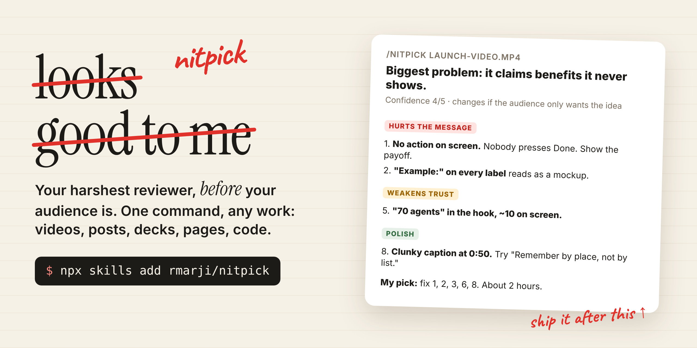

<p align="center"></p>

<h1 align="center">/nitpick</h1>

<p align="center"><b>Your harshest reviewer, before your audience is.</b><br>
One command that tears apart anything you are about to ship, ranks every problem by how much it hurts, and tells you which fixes are worth the time.</p>

<p align="center">
<a href="#install"></a>
<a href="#works-with"></a>
<a href="LICENSE"></a>
</p>

---

AI is great at telling you your work looks good. That is the problem.

`/nitpick` does the opposite. It opens the real thing the way your audience will meet it (stills from every scene of your video, your landing page at phone width, your post as a stranger skims it), hunts for what breaks, and hands you a ranked list with a fix for every item. Then it picks the 3 to 5 fixes worth making and tells you what they cost.

It never edits your work. It just makes sure you know before everyone else does.

## Install

```bash
npx skills add rmarji/nitpick
```

Or in Claude Code as a plugin:

```
/plugin marketplace add rmarji/nitpick
/plugin install nitpick@nitpick
```

Or copy [`skills/nitpick/SKILL.md`](skills/nitpick/SKILL.md) into your agent's skills folder (for Claude Code: `~/.claude/skills/nitpick/SKILL.md`).

## Use it

```
/nitpick
/nitpick launch-video.mp4 --for "X launch, strangers scrolling on a phone"
/nitpick the landing page --depth quick
/nitpick this PR
```

No target means it nitpicks the last thing you made together. Plain language works too: "nitpick this", "tear this apart", "roast this", "what's wrong with this?"

## What you get

A real run on a 60 second launch video, trimmed:

> **Biggest problem: it claims benefits it never shows.** "Act the moment you arrive" is said, but nothing is ever clicked, finished or celebrated. Confidence 4/5. What would change my mind: if your audience mostly wants the idea, not the product.
>
> **Hurts the message**
> 1. **No action on screen.** Nobody presses Done, no confetti, no level-up. The payoff moment is the benefit and it is missing.
> 2. **"Example:" on every label reads as a mockup.** Use realistic fictional names in the video, put the honesty note in the post.
> 3. **The first benefit lands at 0:08.** The aerial has a cloud covering a third of the frame and labels unreadable on a phone.
>
> **Weakens trust**
>
> 5. **"70 AI agents" in the hook, about 10 on screen.** Viewers notice. Say "my agents" or fill the scene.
> 6. **Same location shown twice,** so it looks like there is only one project.
>
> **Polish**
>
> 8. **Clunky caption at 0:50.** Try "Remember by place, not by list."
>
> **My pick:** fix 1, 2, 3, 6 and 8 now (5 and 9 come almost free). About 2 hours of re-render.
>
> Next action: reply "stop and redo" or "let it finish".

## How it judges

Every nitpick runs nine lenses and skips the ones that do not apply:

| Lens | It asks |
|---|---|
| Promise vs proof | Is every claim shown, or only stated? Do the numbers match? |
| Clear to a stranger | After one pass, do they know what it is, who it is for, what to do next? |
| Hook and ending | Do the first 2 seconds earn the rest? Does the end ask for something? |
| Repetition and gaps | Anything shown twice? Anything important never shown? |
| Trust killers | Placeholders, "Example" labels, broken links, stale facts |
| Legibility | Too small for a phone, low contrast, collisions, text gone too fast |
| Voice and copy | Vague, clunky or generic lines ("streamline your workflow") |
| Craft | Pacing, sound, transitions. For code: edge cases, security, performance |
| Privacy | Personal data, secrets, real names that should not go public |

Findings are ranked by damage: **hurts the message**, then **weakens trust**, then **polish**. Every item names the exact spot (timestamp, line, file, element) and comes with a fix. No fix, no item.

## Rules it lives by

- Look at the real thing. Never review from memory or from the plan.
- Honest over nice. No softening real problems, no inventing fake ones to look thorough.
- Praise only when it changes a decision.
- Never fix, rewrite or publish during a nitpick. It offers.

## Works with

Any agent that supports [Agent Skills](https://github.com/vercel-labs/skills): Claude Code, Codex, Cursor, OpenCode, Windsurf and more. It works best with agents that can see images (for videos, designs and pages) and run commands (for screenshots, frames and tests).

## Survived a nitpick?

Put the badge on your README or launch post:

[](https://github.com/rmarji/nitpick)

```markdown
[](https://github.com/rmarji/nitpick)
```

Got a brutal one? Share it in [Discussions](https://github.com/rmarji/nitpick/discussions).

## Credits

Made by [Rayo](https://github.com/rmarji) while launching [Happy Palace](https://github.com/rmarji/happy-palace), after it caught what was wrong with his own launch video before anyone else saw it.

MIT licensed.
